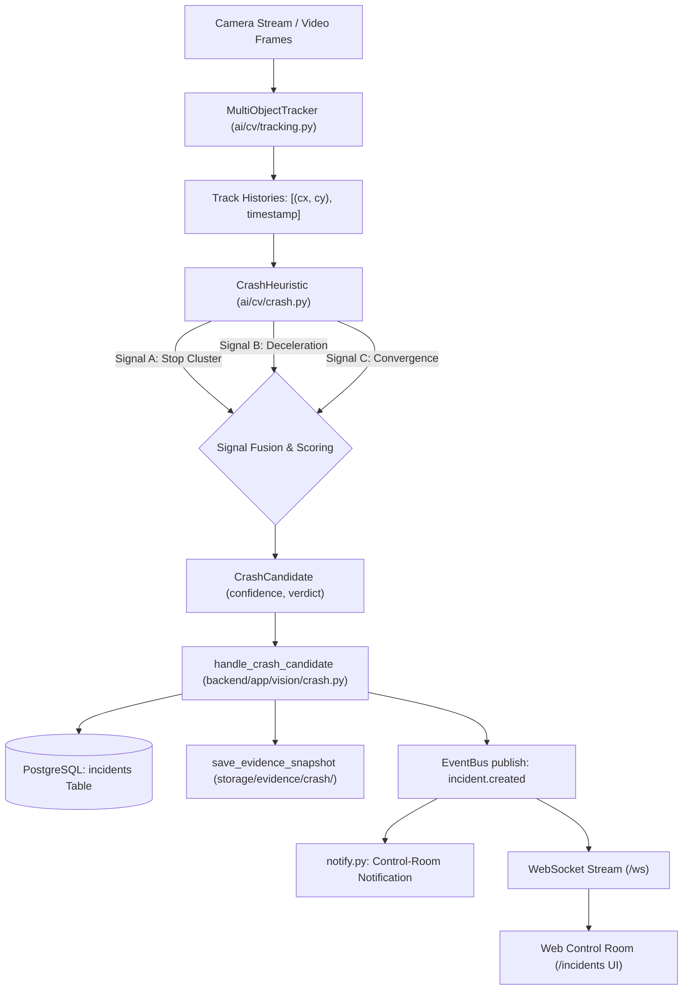

# Automated Crash Detection & Control-Room Alert Pipeline

This document details the architecture, mathematical heuristics, confidence semantics, real-time alert dispatching, and operational boundaries of the Automated Crash Detection subsystem in **AI TrafficOS** (Enhancement Batch 2, Item 2).

---

## 1. Pipeline Overview

The Automated Crash Detection subsystem continuously analyzes vehicle tracking trajectories and speed histories to detect collision and crash candidates without relying on black-box or non-deterministic estimations:



### End-to-End Workflow

1. **Multi-Object Tracking (`ai/cv/tracking.py`):**
   Active vehicles are tracked with persistent integer track IDs, updating historical centroid observations `((cx, cy), timestamp_seconds)` and physical speeds.
2. **Heuristic Perception Engine (`ai/cv/crash.py`):**
   The pure CV heuristic `CrashHeuristic` evaluates active tracks across three deterministic kinematic signals:
   - Multi-vehicle sudden stop cluster.
   - Abrupt deceleration anomaly.
   - Trajectory convergence anomaly.
3. **Scored Crash Candidates:**
   Emits `CrashCandidate` dataclasses carrying involved track IDs, cluster centroid, capture timestamp, individual signal margins, confidence score $[0.0, 1.0]$, and categorical verdict (`likely` vs `possible`).
4. **Backend Bridge & Persistence (`backend/app/vision/crash.py`):**
   `handle_crash_candidate` persists an `Incident` row into the PostgreSQL database:
   - Severity: `high` for `likely` verdict; `medium` for `possible` verdict.
   - Status: strictly initialized to `reported`.
   - Description explicitly states the verdict, confidence, track IDs, and contributing signals.
   - Automated perception writes bypass administrative `AuditLog` to prevent high-frequency write amplification.
5. **Evidence Snapshot Storage (`backend/app/vision/storage.py`):**
   When raw video frames are available, `save_evidence_snapshot` writes the evidence JPEG to `storage/evidence/crash/` and links the path via `evidence_ref`.
6. **Real-Time Alert Dispatch (`backend/app/realtime/bus.py`):**
   The incident is published onto Redis Streams / PubSub using the canonical `incident.created` event type. Payloads contain identifiers, coordinates, verdict, confidence, and snapshot paths—never secrets or raw image bytes.
7. **Control-Room Notifications (`backend/app/realtime/notify.py`):**
   Evaluates the event policy and automatically creates a system-wide broadcast notification for operators:
   - `high` severity (`likely` crash) escalates to `error` notification: `"Crash Alert #{id} (LIKELY)"`.
   - `medium` severity (`possible` crash) creates a `warning` notification: `"Crash Alert #{id} (POSSIBLE)"`.
8. **Web Control Room (`web/src/app/(app)/incidents/page.tsx`):**
   Subscribes to `incident.created` via WebSocket. The incidents table invalidates and updates in real-time, displaying a prominent red `"Crash Auto-Detected"` badge in the incident row and detail drawer.

---

## 2. The Three Heuristic Signals

All signals compute deterministic geometric and kinematic metrics directly on optical tracking histories. No random numbers, fabricated scores, or ungrounded assertions are ever used.

### Signal A: Sudden Multi-Vehicle Stop Cluster
- **Objective:** Detect when $\ge 2$ vehicles transition to a stationary state in close spatial proximity within a short frame/time window.
- **Stationary Threshold:** Evaluated using `StoppedVehicleHeuristic` semantics. Vehicle speed must drop below `stopped_speed_threshold_px_s` (default: $5.0\text{ px/s}$).
- **Freshness Window:** The vehicle must have stopped recently ($\le \text{max\_cluster\_stopped\_frames}$, default: 15 frames) and possessed prior forward motion. Vehicles parked for hours do not trigger fresh clusters.
- **Spatial Proximity:** Euclidean distance between vehicle centroids must be $\le \text{proximity\_threshold\_px}$ (default: $100.0\text{ px}$) or exhibit bounding box IoU overlap.
- **Score Formulation:**
  $$S_a = \min\left(1.0, 0.60 + 0.30 \cdot \left(1.0 - \frac{d_{\text{avg}}}{d_{\text{thresh}}}\right) + 0.10 \cdot (N - 2)\right)$$

### Signal B: Abrupt Deceleration Anomaly
- **Objective:** Detect sudden catastrophic loss of kinetic energy rather than gradual slowing.
- **Windowed Computation:** Divides tracking history into an earlier window $W_{\text{prior}}$ and recent window $W_{\text{recent}}$ using `estimate_speed_from_history`:
  $$\Delta v = v_{\text{prior}} - v_{\text{recent}}, \quad \text{drop\_ratio} = \frac{\Delta v}{\max(v_{\text{prior}}, 10^{-3})}$$
- **Threshold Gating:**
  - $\Delta v \ge \text{deceleration\_drop\_threshold\_px\_s}$ (default: $20.0\text{ px/s}$).
  - $v_{\text{prior}} \ge \text{min\_prior\_speed\_px\_s}$ (default: $15.0\text{ px/s}$).
  - $\text{drop\_ratio} \ge \text{min\_drop\_ratio}$ (default: $0.50$, i.e. vehicle lost $> 50\%$ of its speed abruptly).
- **Gradual Congestion Resistance:** In standard traffic jams, vehicles decelerate smoothly over dozens of frames ($5\text{--}10\text{ px/s}$ drops per window, drop ratio $< 0.35$). Signal B produces zero false positives during traffic congestion.
- **Score Formulation:**
  $$S_b = \min\left(1.0, 0.50 + 0.30 \cdot \min\left(1.0, \frac{\Delta v - \text{thresh}}{25.0}\right) + 0.20 \cdot \text{drop\_ratio}\right)$$

### Signal C: Trajectory Convergence Anomaly
- **Objective:** Determine if two or more tracks were on intersecting/converging trajectories at high combined speed immediately before coming to a stop.
- **Motion Horizon:** Inspects motion vectors either in recent observations or in the pre-stop motion window.
- **Projected Closest Approach:**
  Given relative position $\vec{r} = \vec{p}_b - \vec{p}_a$ and relative velocity $\vec{v}_{\text{rel}} = \vec{v}_b - \vec{v}_a$:
  $$t^* = -\frac{\vec{r} \cdot \vec{v}_{\text{rel}}}{\|\vec{v}_{\text{rel}}\|^2}, \quad 0 < t^* \le t_{\text{lookahead}}$$
  Predicted closest separation:
  $$d_{\text{min}} = \|\vec{r} + \vec{v}_{\text{rel}} t^*\|$$
- **Trigger Condition:**
  - Combined approach speed $s_a + s_b \ge \text{min\_combined\_speed\_px\_s}$ (default: $30.0\text{ px/s}$).
  - $d_{\text{min}} \le \text{convergence\_radius\_px}$ (default: $50.0\text{ px}$) OR empirical separation in history decreased into collision proximity ($< 50\text{ px}$).
- **Score Formulation:**
  $$S_c = \min\left(1.0, 0.50 + 0.30 \cdot \left(1.0 - \frac{d_{\text{min}}}{r_{\text{conv}}}\right) + 0.20 \cdot \frac{s_{\text{comb}} - s_{\text{thresh}}}{40.0}\right)$$

---

## 3. Confidence & Verdict Semantics

The composite confidence score is calculated from the firing pattern and margins of the three physical signals:

| Signal Combination | Margin Weights | Typical Confidence | Verdict |
| :--- | :--- | :--- | :--- |
| **All 3 Signals** (Cluster + Deceleration + Convergence) | $0.35 S_a + 0.35 S_b + 0.20 S_c + 0.10$ | $0.80\text{ -- }0.98$ | **`likely`** |
| **Stop Cluster + Deceleration** | $0.40 S_a + 0.40 S_b + 0.05$ | $0.75\text{ -- }0.88$ | **`likely`** |
| **Stop Cluster Only** (Weak/no deceleration or convergence) | $0.35 + 0.25 S_a$ | $0.45\text{ -- }0.65$ | **`possible`** |
| **Single Vehicle Deceleration Spike** | $0.35 + 0.25 S_b$ | $0.40\text{ -- }0.65$ | **`possible`** |
| **Gradual Congestion / Jam** | No signals fire | $0.00$ | *No candidate emitted* |

### Strict Anti-Hallucination Policy
- **Boundary:** $\text{Confidence} \ge 0.75 \implies \text{verdict} = \textbf{`likely`}$; otherwise $\text{verdict} = \textbf{`possible`}$.
- **Low-Confidence Floor:** Any event lacking multi-track convergence and multi-vehicle spatial clustering remains strictly **`possible`**. The system **never asserts a crash** that cannot be physically supported by multiple independent trajectory signals.
- **Cooldown Deduplication:** Active clusters maintain a configurable 10-second cooldown per track set to prevent duplicate notification floods while vehicles remain stationary awaiting triage.

---

## 4. Database Schema & REST API Integration

### Database Mapping (`Incident` Model)
Crash candidates map directly to the existing core `Incident` table (`backend/app/models/event.py`), eliminating the need for schema migrations or separate tables:
- `intersection_id`: Intersection foreign key where camera is mounted.
- `severity`: `'high'` for `likely` verdict; `'medium'` for `possible` verdict.
- `status`: `'reported'`.
- `description`: Formatted with explicit verdict and signal audit details (e.g. `"Likely crash detected (confidence 0.88): tracks [11, 12] (multi_vehicle_stop_cluster, abrupt_deceleration, trajectory_convergence) [evidence: storage/evidence/crash/...]"`).
- `reported_by`: `None` (denoting automated sensor origin, distinct from human traffic officers).

### REST API Query Filter
Control-room operators and external clients can query crash-specific incidents using query parameters on the standard incidents endpoint (`GET /api/v1/incidents`):
- `is_crash=true`: Filters strictly for crash-detected incidents (`description ILIKE '%crash%'`).
- `is_crash=false`: Excludes crash-detected incidents from general maintenance/hazard queries.
- `search=<keyword>`: Searches across description keywords (e.g. track IDs or camera tags).

Example Request:
```bash
curl -X GET "http://localhost:8000/api/v1/incidents?is_crash=true&page=1&per_page=20" \
     -H "Authorization: Bearer <token>"
```

---

## 5. Control Room Visual Interface

In the Next.js Web Control Room (`web/src/app/(app)/incidents/page.tsx`):
1. **Real-time Synchronization:**
   The page listens to the WebSocket topic `incident.created` via `useTopic("incident.created", ...)`. The incident list invalidates and refreshes instantaneously when a collision is detected.
2. **Crash Auto-Detected Visual Badge:**
   Incidents identified by `CrashHeuristic` automatically render a bright red `<Badge variant="danger">Crash Auto-Detected</Badge>` directly above their description in the main incident ledger.
3. **Detail Drawer Inspection:**
   Selecting an incident opens the triage drawer featuring the `Crash Auto-Detected` badge, full tracking kinematics, snapshot evidence path, and quick-action buttons (`Acknowledge`, `Resolve`).

---

## 6. Operational Boundaries & Honest Accuracy Limits

1. **2D Optical Heuristic Limitations:**
   The detector operates on 2D camera coordinates $(x, y)$. Without multi-view 3D LiDAR or calibrated ground-plane homography, monocular perspective effects (e.g. vehicles passing close to the camera lens appearing to move faster or closer together) can introduce optical noise.
2. **Occlusions & Weather Interference:**
   Heavy rain, glare, headlight bloom at night, or occlusion by tall commercial trucks may cause intermittent track loss, which resets velocity smoothing windows.
3. **No Ground-Truth Crash Dataset Validation:**
   This environment uses deterministic synthetic frame sequences (`test_crash_heuristic.py` and `test_crash_bridge.py`) for regression testing. The heuristic has **not** been benchmarked against a real-world annotated crash video dataset in this deployment.
4. **Live-Camera Authorization Limitation:**
   Processing live intersection feeds requires authorized municipal RTSP/ONVIF credentials and site-specific pixel-to-meter camera calibration homographies. Automated detections are designated as **advisory candidates** requiring officer verification before dispatching emergency medical or towing services.
